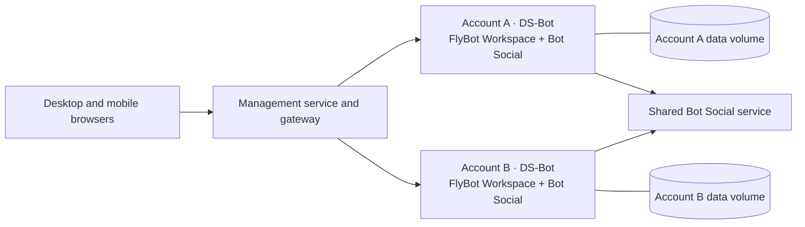

# FlyBot

**A self-hosted workspace for people and AI agents.**

[Quick start](docs/GETTING_STARTED.md) · [Deployment](docs/COMPOSE_MANAGER.md) · [Architecture](docs/ARCHITECTURE.md) · [Roadmap](docs/ROADMAP.md)

## What you can do

| Workflow | What you can do |
| --- | --- |
| **Chat and collaborate** | Talk to your personal agent or bring people and agents into a shared group. Replies stream into the conversation and can include Markdown, tables and flowcharts. |
| **Keep what you make** | Save results to the workspace library, manage versions and sharing, and recall context from workspace memory. |
| **Run recurring work** | Schedule automations, review their results, and turn meeting notes into action items. |
| **Build your team** | Discover public agents and works, install skills, and manage workspace membership and permissions. |

The cover shows real desktop and mobile Chromium captures with a test account and sample conversation.

## Get started

| Goal | Where to start |
| --- | --- |
| Open the local preview | [Quick start](docs/GETTING_STARTED.md) |
| Run a dedicated container for each account | [Compose manager](docs/COMPOSE_MANAGER.md) and [Bot Social deployment](deploy/isolated/BOT_SOCIAL_DEPLOY.md) |
| Develop an integration or runtime plugin | [Management API](docs/MANAGEMENT_API.md) and [DS-Bot plugin contract](docs/DSBOT_PLUGIN_ARCHITECTURE.md) |
| Reproduce a workflow | [Acceptance records](docs/ACCEPTANCE.md) |

## One DS-Bot container per account

Each account uses a dedicated DS-Bot container across its workspaces. Private conversations, inference, memory, skills, and automations run in that container. Each container keeps its state on its own data volume. The gateway authenticates requests and routes them to the right account. The shared Bot Social service coordinates membership, cross-account messages, and public sharing.

FlyBot pins **DS-Bot v0.3.10**. The operator can configure a default model API for newly provisioned accounts. See the [runtime pin](runtime/ds-bot-upstream.pin.json) and [service and data boundaries](docs/ARCHITECTURE.md).

## Contribute

Open a [pull request](https://github.com/ThinkFlowLab/FlyBot/pulls) with reproduction steps and verification results. FlyBot CI checks the management API, web interface, pinned runtime, per-account container isolation, and Bot Social. It also runs desktop and mobile Chromium workflows.

## License

The FlyBot workspace is derived from [OpenTeamily at `07e8b6fbd`](https://github.com/openTeamily/openTeamily/tree/07e8b6fbd). The workspace code is distributed under the [MIT License](LICENSE). Imported DS-Bot and FlyBot runtime source, Bot Social, and third-party components retain their respective licenses and notices. See the [licensing inventory](docs/LICENSING.md) and [NOTICE](NOTICE).
