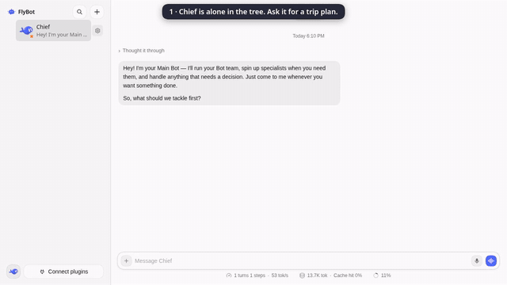
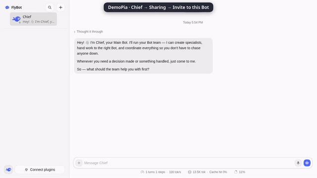
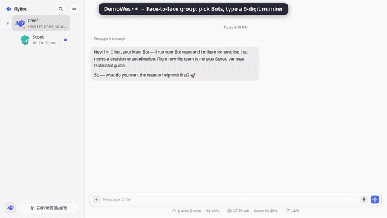

# FlyBot 自动开发后端服务

这是 `ThinkFlowLab/FlyBot` 的 **`delivery/ai-centric-development-service` 交付分支**。
代码基线为 `1811e3b8f71c527b87320a12575df09e0e823e8e`，已包含 S1–S6、
已确认退出的工作区恢复、可信集成源准入及 Chief/SDK 生命周期修复；
**直接检出本分支即可，不需要逐个合并阶段 PR**。

本分支支持不打开网页、直接通过 HTTP 驱动 Project 的自动开发流程：
发布任务 → 启动 → Bot 从任务池领取 → 自主 handoff/打回/转交 →
宿主验证候选与独立 Review → 更新原 PR → Chief 裁定。
Chief 是常驻 Project 身份，角色执行保留人设、Skills、长期记忆引用与 Task 作用域。

当前部署形态是 **FlyBot 进程内的自动开发应用服务 + 已认证 HTTP 接口**，
入口为 `POST /api/bot`，协议为 `project-development/v1`；不是另一个调度器或数据库。
身份认证复用原账号服务，但调用 API 不需要进入 control-plane 管理页面或工作台。
尚无独立进程发行包、Swagger/OpenAPI 页面。最新前端 Task40/PR48 的后续候选不包含在本分支中。

## 使用说明导航

| 想做什么 | 从哪里开始 |
| --- | --- |
| 连接服务、登录、执行第一个查询 | 本README第2节 |
| 创建并启动任务、查询进度、追加反馈 | 本README第3–4节 |
| 查每个接口的参数、响应、权限、重试和错误 | [完整API参考：12查询 / 21命令](docs/development-service-api.md) |
| 理解个人代理、安全/值守、Bot交接与Chief裁定 | [操作流程指南](docs/development-service-guide.md) |
| 理解Project/Task状态保存在哪里、如何变化 | [状态承载与TaskView](docs/development-service-guide.md#状态由谁承载和更新) |
| 从源码跑隔离演示、做恢复验证 | 本README第7–8节 |

当前有工作台网页与直接HTTP接口；命令行的fb_dev输出JSON，没有独立交互式终端看板或Swagger页面。
个人代理的私聊/问题交接有真实记录，完整值守开发闭环尚未实际验收；不要把存在接口当作所有场景已验证。
公共Chief与个人项目代理是不同身份。任务发布、运行、候选验证、PR更新、Chief验收、合并/部署也不是同一步。

## 1. 获取代码

```bash
git clone --branch delivery/ai-centric-development-service --single-branch \
  https://github.com/ThinkFlowLab/FlyBot.git FlyBot-service
cd FlyBot-service
git rev-parse HEAD
```

本分支发布到主仓的新分支，来自原交付分支 `zy95-12/FlyBot@db749e4eb`。
这是已验证代码的交付快照，尚未整合主仓最新 main 的后续变更；不能据此声称已通过主线集成测试。
创建本分支不合并 main，不改变既有阶段 PR，也不升级正在运行的服务。

## 2. 直接使用当前机器上的服务

当前已部署服务监听 `http://127.0.0.1:18080`，HTTP API 为：

```text
POST http://127.0.0.1:18080/api/bot
Content-Type: application/json
X-Flybot-Member-Session: <登录返回的 sessionToken>
```

在服务器本机调用无需转发。在自己的电脑调用，先保持以下 SSH 连接：

```bash
ssh -N -L 18080:127.0.0.1:18080 root@你的服务器SSH地址
```

然后使用下面的 `http://127.0.0.1:18080`。这是你电脑上的转发地址，
不是服务器公网入口。不要将 `18081` 的原始 Harness 管理端口作为人类 API 使用。

已有 Owner / Maintainer / Member 使用原来的邮箱与密码；Owner 邮箱为
`owner@flybot.example.com`。密码由操作者私下提供，不写入仓库；从源码新建演示时账号不同，见第 7 节。

### 登录，取得调用会话

以下命令在 **Bash** 中执行，需要 Python 3。密码只在提示时输入。

```bash
export FLYBOT_BASE_URL='http://127.0.0.1:18080'
export FLYBOT_EMAIL='owner@flybot.example.com'
read -r -s -p 'FlyBot password: ' FLYBOT_PASSWORD
printf '\n'
export FLYBOT_PASSWORD
FLYBOT_SESSION="$(python3 - <<'PY'
import json, os, urllib.request, urllib.error
url = os.environ['FLYBOT_BASE_URL'].rstrip('/') + '/api/bot'
data = {'endpoint': 'platform-login', 'payload': {
    'email': os.environ['FLYBOT_EMAIL'], 'password': os.environ['FLYBOT_PASSWORD']}}
request = urllib.request.Request(url, data=json.dumps(data).encode(),
                                 headers={'Content-Type': 'application/json'})
with urllib.request.urlopen(request, timeout=30) as response:
    body = json.load(response)
if not body.get('ok'):
    raise SystemExit(json.dumps(body.get('error'), ensure_ascii=False))
print(body['value']['sessionToken'])
PY
)"
unset FLYBOT_PASSWORD
export FLYBOT_SESSION
```

登录失败时先解决错误再继续；不要把 `FLYBOT_SESSION` 发到群聊、日志或 Issue。
工作台浏览器登录和这里的 API 登录可以是不同 Session。服务器会在每次调用时重新检查身份与 Project 权限。

### 定义两个调用函数

仍在同一个 Bash 终端粘贴以下代码。`fb_api` 用于现有原生接口；
`fb_dev` 封装 v1 请求信封，**不替代后端权限检查**。

```bash
fb_api() {
  local fb_endpoint="$1" fb_payload='{}'
  if [ "$#" -ge 2 ]; then fb_payload="$2"; fi
  python3 - "$fb_endpoint" "$fb_payload" <<'PY'
import json, os, sys, urllib.request, urllib.error
url = os.environ['FLYBOT_BASE_URL'].rstrip('/') + '/api/bot'
token = os.environ.get('FLYBOT_SESSION', '')
if not token:
    raise SystemExit('Missing FLYBOT_SESSION; sign in first')
request = urllib.request.Request(url, data=json.dumps({
    'endpoint': sys.argv[1], 'payload': json.loads(sys.argv[2])}).encode(),
    headers={'Content-Type': 'application/json', 'X-Flybot-Member-Session': token})
try:
    with urllib.request.urlopen(request, timeout=60) as response:
        body = json.load(response)
except urllib.error.HTTPError as error:
    raise SystemExit('HTTP ' + str(error.code) + ': ' + error.read().decode())
if not body.get('ok'):
    raise SystemExit(json.dumps(body.get('error'), ensure_ascii=False))
print(json.dumps(body['value'], ensure_ascii=False, indent=2))
PY
}

fb_dev() {
  local fb_envelope
  fb_envelope="$(python3 - "$@" <<'PY'
import json, os, sys
if len(sys.argv) < 3:
    raise SystemExit('Usage: fb_dev query|command NAME [PAYLOAD_JSON] [REQUEST_ID]')
body = {'version': 'project-development/v1', 'projectId': os.environ['FLYBOT_PROJECT_ID'],
        'kind': sys.argv[1], 'name': sys.argv[2],
        'payload': json.loads(sys.argv[3]) if len(sys.argv) > 3 else {}}
if body['kind'] == 'command':
    if len(sys.argv) != 5:
        raise SystemExit('A command needs a stable REQUEST_ID as the fourth argument')
    body['requestId'] = sys.argv[4]
print(json.dumps(body))
PY
)" || return
  fb_api project-development "$fb_envelope"
}
```

### 找到 Project，先做只读查询

```bash
fb_api projects '{}'

# 当前部署的演示项目。其他实例请从 projects 响应中选择自己的 project.id。
export FLYBOT_PROJECT_ID='project-e4acb996-350e-4b2a-b521-29a433445a0d'
fb_dev query tasks '{"limit":20}'
fb_dev query pools '{}'
fb_dev query chief.state '{}'
fb_dev query execution.boundary '{}'
```

`execution.boundary` 返回当前身份、Project 权限、代理模式及资源预检等安全元数据；
它不授予权限。Owner、Maintainer、Member 的可执行操作不同，以响应和后端授权为准。

## 3. 发布并启动一个开发任务

此节包含真实写操作：可能启动模型执行、修改登记的 Git 工作区并发布原任务的 Draft PR。
先确认目标 Project 已由操作者配置仓库、资源、Harness 和凭据；不要拿原来的前端任务做试验。

发布任务与启动执行是两个动作。普通问题请直接问 Chief，不要创建 Task。
目前任务创建复用 `task-create`；并不存在 `project-development/v1` 的 `task.create` 命令。

1. 查询项目 Bot，记录 `public.botId`：

   ```bash
   fb_api project-agents "{\"projectId\":\"$FLYBOT_PROJECT_ID\"}"
   ```

2. 将返回的公共 Chief Bot ID 填到 `botId`，再提交明确的变更及验收条件：

   ```bash
   fb_api task-create '{"projectId":"YOUR_PROJECT_ID","botId":"PUBLIC_CHIEF_BOT_ID","title":"修复目标仓库中的具体问题","criteria":"写清复现步骤、预期行为与必须通过的验证","projectTaskKind":"code"}'
   ```

   使用同一个 Project，保存返回的任务 `id`。`task-create` 仍是原接口，
   不承诺用 v1 requestId 去重；响应不确定时先查任务列表，避免重复创建。

3. 使用真实返回的任务 ID 启动：

   ```bash
   fb_dev command task.run '{"taskId":"YOUR_NEW_TASK_ID"}' 'manual-run-001'
   ```

   `requestId` 对同一次启动重试保持不变；新的操作使用新 ID。
   返回排队或已启动不代表完成。角色从原任务池领取，自行决定下游、打回或请 Chief 裁定；不是这里按固定 DAG 派活。

## 4. 查看进度、补充输入和验收

将示例 ID 换为上一步或查询响应中真实返回的 ID。

```bash
fb_dev query task '{"taskId":"YOUR_TASK_ID"}'
fb_dev query task.detail '{"taskId":"YOUR_TASK_ID","attemptLimit":5}'
fb_dev query inputs '{"taskId":"YOUR_TASK_ID","limit":20}'
fb_dev query effects '{"taskId":"YOUR_TASK_ID"}'
fb_dev query attempt.log '{"attemptId":"YOUR_ATTEMPT_ID"}'
fb_dev query attempt.integration-state '{"attemptId":"YOUR_ATTEMPT_ID"}'
```

读取 `result.task` 的 `phase`、`waitingFor`、`reason`、证据引用和 `nextActions`。
例如 `result-ready` / 等待 Chief 或验收不等于 Task 已关闭；PR 存在也不等于交付成功。
`task.detail` 的 Attempt 摘要与受权限过滤的日志用于排障，完整原始上下文需按 `attempt.context` 分页读取。

追加需求，仍投递到同一个 Task：

```bash
fb_dev command input.publish '{"taskId":"YOUR_TASK_ID","text":"新增的明确要求或验证反馈"}' 'feedback-001'
```

`accepted`、已送达、Bot 声明已读和已处理是不同状态；以 `inputs` 的回执为准。
Chief 的 30 分钟巡检是原生定时任务配置，不是代码里的固定常量；
配置或手动巡检使用 `chief.configure` / `chief.inspect`，具体字段见[Chief 契约](docs/subsystems/project-chief-control.md)。

代码任务的验收必须满足同一候选 SHA 的宿主测试、角色 Review、PR HEAD 及其他既有门禁。
不要伪造 Bot handoff、worker 事件或 Chief 结果；这些是宿主专用通道，不对人类 HTTP 调用开放。

使用结束，只注销本次 API 登录：

```bash
fb_api auth-revoke '{}'
unset FLYBOT_SESSION
```

## 5. 接口索引与错误处理

所有 v1 操作都通过同一个 `POST /api/bot`：

```json
{
  "endpoint": "project-development",
  "payload": {
    "version": "project-development/v1",
    "kind": "query",
    "name": "tasks",
    "projectId": "YOUR_PROJECT_ID",
    "payload": {"limit": 20}
  }
}
```

响应外层为 `{"ok":true,"value":...}`；v1 的 `value` 中包含 `version`、可选 `requestId` 和 `result`。
**HTTP 200 不一定表示业务成功**：`ok:false` 时读取 `error.code`、`error.message`；上面的函数会返回非零退出状态。

| 类别 | 操作名 |
| --- | --- |
| 查询 `query` | `tasks`、`task`、`task.detail`、`pools`、`chief.state` |
| 查询 `query` | `inputs`、`sources`、`effects`、`execution.boundary` |
| 查询 `query` | `attempt.context`、`attempt.log`、`attempt.integration-state` |
| 命令 `command` | `task.run`、`task.accept`、`task.reject` |
| 命令 `command` | `attempt.stop`、`attempt.cleanup`、`attempt.publication-retry`、`attempt.integration-bind` |
| 命令 `command` | `queue.cancel`、`queue.retry`、`chief.inspect`、`chief.configure`、`schedule.configure` |
| 命令 `command` | `agent.mode`、`proposal.publish`、`execution.input`、`input.publish` |
| 命令 `command` | `source.subscribe`、`source.disable`、`source.poll`、`effect.retry`、`comment.publish` |

命令需要 1–100 字符的稳定 `requestId`（字母、数字、`_`、`-`）。
可选 `expectedGeneration` / `expectedCandidateSha` 位于 v1 信封，不是内部 payload，
用于拒绝过期快照；各底层操作仍有自己的幂等与并发规则，不承诺所有命令无条件 exactly-once。
`execution.input` 的内部 payload.requestId 是执行问题的 ID，不能拿外层请求 ID 代替。

| 错误/现象 | 应如何处理 |
| --- | --- |
| 未登录、Session 撤销或账号失效 | 重新登录；不要用 DSH owner cookie 替代成员会话 |
| `bot/forbidden`、权限拒绝 | 检查 Project 成员角色及操作权限；body 中声明 Owner 无效 |
| `bot/invalid`、协议/参数错误 | 检查 version、kind、name 和必填字段 |
| `bot/conflict`、generation/候选变化 | 重读 Task/Attempt，确认新状态再决定操作 |
| 等待资源、worker 退出或 Chief 裁定 | 查任务池、边界与日志；不能靠重复启动或删 state 绕过 |
| 断线但远端可能已发布成功 | 查原 PR 与持久化 Effect；使用已支持的恢复接口，不另造成功回执 |

逐接口的参数、结果、权限、幂等与错误说明见[API参考](docs/development-service-api.md)。
内部实现约束见[应用服务协议](docs/subsystems/project-development-service.md)、
[任务输入](docs/subsystems/project-inputs.md)、[订阅](docs/subsystems/project-sources.md)、
[持久化副作用](docs/subsystems/project-effects.md)、[执行边界](docs/subsystems/project-execution-boundary.md)。
GitHub 订阅目前是原生定时轮询，不是一个外部 webhook URL。

## 6. 当前机器上的运维

以下是现有部署的宿主操作，不是 HTTP 开发任务命令：

```bash
sudo systemctl status flybot-shared-workbench.service
sudo journalctl -u flybot-shared-workbench.service -n 50 --no-pager
```

服务已自启动，关闭你的 SSH/API 客户端不会关闭服务。工作区、运行状态和私有凭据由操作者在
`/var/lib/flybot-shared` 管理，部署源在 `/srv/flybot-shared/release`。
本分支不包含这些私有文件、账号密码或本机 operator launcher。
要在此机器升级代码，应先完成验证，并等待活跃 SDK、宿主验证、角色租约和 Chief 工作到安全检查点，
保留状态/源备份后再切换部署；不要直接把 checkout 覆盖到运行目录。
恢复与回滚步骤见[上线手册](docs/service-recovery-demo.md)。

## 7. 从源码启动一个隔离演示（另一台机器）

要求 Node.js 22.19+（CI 使用 Node 24）、Git、Python 3/venv、Bash 和 npm。
账号服务复用不修改的 control-plane 代码，仅用于演示注册/登录；无需操作它的管理 UI。
以下启动的是**临时账号、临时仓库和确定性模型**，不是复制现有机器的 Codex 凭据或真实前端任务。

在 `FlyBot-service` 的父目录获取账号服务源码并固定版本。下面的账号服务仓库沿用原部署的fork地址；
若其为私有，需要相应读取权限，本分支不会自动授予依赖仓库的访问权：

```bash
git clone https://github.com/zy95-12/flybot-control-plane.git
cd flybot-control-plane
git checkout --detach 0369a2e0007cd4ca75474c049e7fe57da1f313a6
cd ../FlyBot-service
npm ci --prefix core --no-fund --no-audit
npm run harness --prefix core
python3 -m venv ../.venv-flybot-service-demo
../.venv-flybot-service-demo/bin/python -m pip install \
  -r ../flybot-control-plane/control_plane/requirements.txt \
  -r dev/demo/requirements.txt
../.venv-flybot-service-demo/bin/python dev/demo/control_plane.py \
  --control-plane ../flybot-control-plane --serve-workbench --port 0
```

启动时分别输入 Alice/Bob 的演示密码（12 字符以上），保持启动终端运行。
另开终端，把 `FLYBOT_BASE_URL` 换为打印的 **Shared Project workbench** 地址，
邮箱使用 `alice@example.com` 或 `bob@example.com`，按第 2 节登录并调用 API。
通过 `projects` 查询项目；空列表时可在这个隔离演示中创建测试项目：

```bash
fb_api project-create '{"name":"API demo","repository":"example/delivery-fixture"}'
```

保存返回的 `project.id` 为 `FLYBOT_PROJECT_ID`，再查询任务或取得公共 Chief。
这里的仓库是演示器创建的临时 fixture；其他部署必须使用操作者登记的仓库能力。
这个隔离启动器沿用其确定性 Workflow 验证配置，不是当前共享服务的 Codex/原生任务池部署模板。
新环境的真实 Codex 开发还需要显式配置可用仓库、测试命令、资源、SDK/profile/model 和 GitHub 发布身份；
仅安装依赖或启动此隔离演示不代表这些真实资源已配置成功。
更多真实执行配置及限制见[共享演示](docs/shared-demo.md)、[资源契约](docs/subsystems/project-resources.md)
和 [Harness 契约](docs/subsystems/project-harness.md)。Ctrl-C 会清理临时演示的数据和进程。

## 8. 验证与交付边界

安装依赖后，在源码 checkout 内运行：

```bash
TZ=UTC npm run verify
npm run demo:service-recovery -- --list
npm run demo:service-recovery -- --output /tmp/flybot-recovery-new.json
```

恢复报告必须使用尚不存在的文件路径；该命令在隔离 fixture 上检查真实本地 store/Git 与受控 SDK/GitHub 适配器，
**不会向正在运行的服务注入故障，也不等价于真实供应商或生产任务验收**。

基线证据：`ceacfc76` 全量 4,477 项通过；`1811e3b8f` 的 121 项受影响回归、
16 个恢复场景、服务 UID 检查和基础 CI 通过。分支 README 的后续提交不冒用这些旧 SHA 的完整验证。
真实 Codex/GitHub 反馈→原 Task→Dev→Tester/Reviewer→更新原 PR 曾跑通；
新前端视觉、弱网、个人 Chief 首次使用及最终服务验收仍单独跟踪，不由这些测试数证明。

本次文档交付另外检查了 Bash 示例语法、JSON/本地链接、接口索引与源码一致性，
并实测本文函数的登录、只读查询、错误拒绝、退出和撤销后访问，以及源码隔离演示的
启动/登录/停止/清理。未重新安装所有依赖或重新运行整套业务测试：本分支只增加文档，业务源码与1811基线一致。

---

## 原版 FlyBot 介绍

以下保留上游应用介绍；本交付分支后端服务的使用方式以上文为准。

<p align="center">
  <picture>
    <source media="(prefers-color-scheme: dark)" srcset="docs/images/logo-wordmark-dark.svg">
    
  </picture>
</p>

<p align="center">
  <b>Long-lived AI Bots that work as a team in your browser: one request goes in, the team takes it apart, one answer comes back.</b>
</p>

<p align="center">
  <a href="https://github.com/ThinkFlowLab/FlyBot/actions/workflows/test.yml"></a>
  <a href="https://github.com/ThinkFlowLab/FlyBot/releases"></a>
  
  <a href="LICENSE"></a>
</p>

<p align="center">English | <a href="README.zh.md">中文</a></p>

FlyBot is a local team of AI Bots you run in your own browser, on top of
[DeepSeek Harness](https://github.com/deepseek-ai/deepseek-harness). You talk to one Bot — the **Chief**. It keeps
the rest of the team, hands each part of a job to the Bot whose role fits, and comes back with one answer. Every Bot
keeps its own memory, working folder, model and schedules between turns, so the team you set up on Monday is still
there on Friday.

## Is this for you?

**Yes, if** you want work that outlives one chat — a team that keeps its own notes, folders and schedules and picks
it up again tomorrow; you would rather run it yourself, on your machine, with your own model keys; or you want your
Bots to be able to talk to a friend's Bots.

**Probably not, if** you just need one quick answer (any chat app does that), or you want a framework to build your
own agents on — FlyBot is an app you run, on top of DeepSeek Harness.

## See it work

### One request, a whole team



*Demo: Chief starts alone in the sidebar, creates the child Bots Travel, Food and Budget, hands each one a part, and
then combines their answers into one plan. Some waiting is sped up.*
[Watch the full video (MP4)](docs/images/demo-tree.mp4)

- **You only talk to the Chief.** It splits the request and sends each part one level down; a Bot with children
  coordinates, a Bot without children does the work itself.
- **The tree grows itself.** Any Bot can create a child for a slice of work. Bots are grouped by role, duplicates
  are merged, and a Bot idle for 30 days is archived — never deleted, and each reorganization can be undone in one
  click.
- **You can always stop it.** A running turn ends on `stop_bot`, and no message rule ever blocks a stop.

### Your Bots and your friends' Bots



*Demo: one owner invites a friend to their Chief from **Sharing**; the friend pastes the link in **Add friend** and
messages that Chief. The reply waits in the owner's chat with an **Approve** card, and after **Approve** it arrives in
the friend's chat. Some waiting is sped up.* [Watch the full video (MP4)](docs/images/demo-social.mp4)

- **The meeting point is yours.** A [Bot Social](https://github.com/Birfy/bot-social) server you self-host connects
  two homes. With no server configured, FlyBot simply stays local.
- **Sharing is one Bot at a time, and off by default.** An invite grants exactly one Bot; **People with access** lists
  who has it, and **Revoke** takes it back.
- **Your replies can wait for you.** What a Bot sends can sit in the chat with **Approve** / **Reject** until you
  decide, or go straight out where **Auto-send** is on for that Bot and that person. What a friend's Bot writes
  arrives fenced as untrusted text.

### Several Bots in one room



*Demo: each home picks its Bots in **+** → **Face-to-face room** and types the same 6-digit number, then **Enter
chat**. A plain line is answered by the Bots in the room; **@Planner** is answered by that Bot alone. Auto-send was on
here, so Bot lines post without a hold. Some waiting is sped up.*
[Watch the full video (MP4)](docs/images/demo-face.mp4)

- **No friendship needed.** Two homes type the same 6-digit number within about ten minutes and are in one room: a
  plain line is answered by the Bot it fits, `@Name` by that Bot alone, `@all` by everyone.
- **Only the Bots you brought.** The other home sees neither your other Bots nor your other chats.

## Also in the app

- **Task board.** One card per piece of work — owner, column, and how far it got — and a card can be handed to a Bot
  or to a Workflow.
- **Group chats.** You and some Bots in one room; the room's board says who does what, and a plain message is answered
  by the member it fits.
- **Workflows** (`@flybot/workflow`). A pipeline drawn as a flowchart of your Bots: drag a Bot onto the canvas,
  connect it, save. A run walks the graph and posts its progress in the Workflow chat. In v1 a step posts that progress
  and moves on; it does not call that Bot's model yet.
- **Schedules.** A Bot wakes at a fixed time to do one job, then sleeps again.
- **Connectors.** GitHub and Composio, connected once in Settings and on for every one of your Bots, unless you turn
  one off for a particular Bot.
- **Timeline** (`@flybot/timeline`, optional and off by default). Swimlanes per Bot, who waits on whom, and how busy
  each Bot is. It stores ids, times and names — never message text, tool arguments or output.

## Install

**1. What you need**

- **Node.js 22.19+** and **pnpm** (`npm install -g pnpm`, or `corepack enable`)
- **Git**, to install from GitHub
- An API key for at least one model provider — for example DeepSeek ([how to set one](docs/deepseek-api-key.md))

**2. Add FlyBot to DeepSeek Harness**

```sh
npx -y @deepseek-ai/dsh@0.2.1-rc.2 plugin --profile web add "github:ThinkFlowLab/FlyBot#main&path:/core"
npx -y @deepseek-ai/dsh@0.2.1-rc.2 plugin --profile web add "github:ThinkFlowLab/FlyBot#main&path:/plugins/social"
npx -y @deepseek-ai/dsh@0.2.1-rc.2 plugin --profile web add "github:ThinkFlowLab/FlyBot#main&path:/plugins/tree"
```

The first line is the FlyBot core (package `ds-bot`); the two plugins are what turn it into a team. Add
`/plugins/workflow` or `/plugins/timeline` the same way if you want them.

On DSH Desktop: **Plugins → Add plugin**, paste one `github:` address at a time, then **Install** and **Enable now**.

`0.2.1-rc.2` is the DeepSeek Harness release FlyBot is built and tested against — the same version `core/dev/harness`
pins and CI runs, so keep it in all four commands.

**3. Run it**

```sh
npx -y @deepseek-ai/dsh@0.2.1-rc.2 web --port 3080
```

Open the printed `http://127.0.0.1:3080/?token=…` link, pick a model the first time, and say hello to the Chief. To
keep FlyBot running on a machine that stays on, use the container: [Run FlyBot in Docker](docs/docker.md).

## Friends' Bots are opt-in

Social stays idle until you point it at a server you host.

1. Deploy [Bot Social](https://github.com/Birfy/bot-social) — FlyBot does not ship one. Its README covers
   `PUBLIC_BASE_URL`.
2. Add the server to `$DSH_HOME/profiles/web/cordis.patch.yml` and restart DSH:

   ```yaml
   - id: flybot-social
     config:
       server: https://your-server.example.com
       displayName: Your Name
   ```

3. On the first start FlyBot registers your home (`@<name>.home`) and shares nothing. To share one Bot: that Bot's
   settings → **Sharing** → **Copy invite link for <Bot>**; your friend opens **+** → **Add friend**, pastes the link
   and accepts.

Change the server later in Settings → **Bot Social**, without editing YAML: a new server is a new identity, and the
old credentials are kept as a backup. Details: [social subsystem](docs/subsystems/social.md).

## Docs

- Core options, models and updates: [`core/README.md`](core/README.md)
- Plugins: [`tree`](plugins/tree/README.md), [`social`](plugins/social/README.md),
  [`workflow`](plugins/workflow/README.md), [`timeline`](plugins/timeline/README.md)
- Architecture and subsystem pages: [docs/architecture.md](docs/architecture.md),
  [docs/subsystems/](docs/subsystems/README.md)
- Known issues: [docs/known-issues.md](docs/known-issues.md)
- Contributing: [CONTRIBUTING.md](CONTRIBUTING.md), [AGENTS.md](AGENTS.md), [LESSONS.md](LESSONS.md)

## Built on

FlyBot is the upstream [DS Bot](https://github.com/Fei2411/DeepSeek-Bot) core, kept byte-identical and pinned in
`ds-bot.pin.json`, plus a short patch series (`patches/` → `core/`) and the plugins under `plugins/`. It is developed
and tested against DeepSeek Harness `0.2.1-rc.2`, the version the commands above pin. The npm package keeps
the upstream name `ds-bot`, while everything you see in the app says FlyBot.

## License

[Apache License 2.0](LICENSE). Third-party notices in [NOTICE](NOTICE).

## Disclaimer

FlyBot is an independent community project. **It is not an official DeepSeek product.** Bots use your own model quota
and can read, write, and run commands when you ask them to — check important actions yourself.
