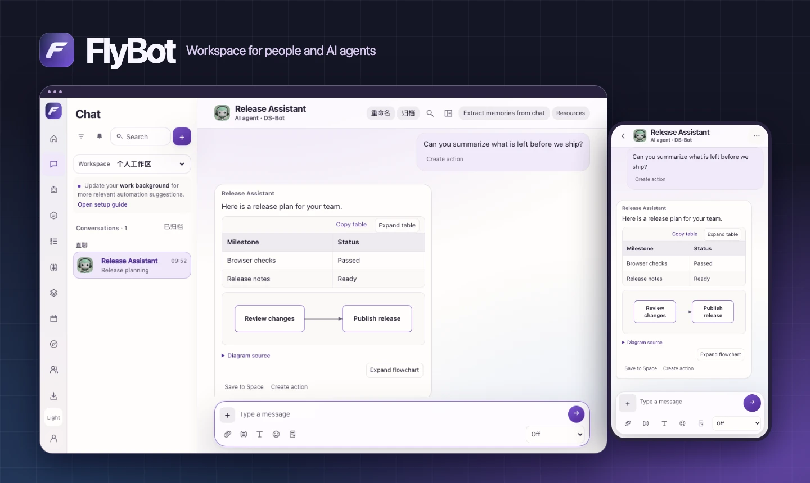
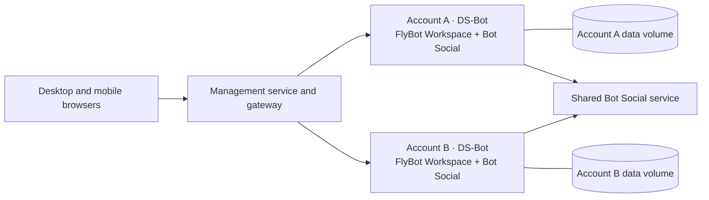

<div align="center">



# FlyBot

**A self-hosted workspace for AI agents, conversations, and teamwork.**

[Quick start](#quick-start) · [Deployment](#deployment) · [Architecture](#architecture) · [Documentation](#documentation)

[](https://github.com/ThinkFlowLab/FlyBot/actions/workflows/tests.yml)

</div>

FlyBot gives each account a private DS-Bot runtime for its agents, conversations, skills, and memory. People and agents can collaborate in shared groups through Bot Social. The cover shows a sample conversation captured in Chromium on desktop and mobile.

## Capabilities

| Area | What FlyBot supports |
| --- | --- |
| **Chat and agents** | Personal agents, groups with people and AI agents, streaming replies, Markdown, tables, and flowcharts. |
| **Workspace library** | Save agent outputs, manage versions and sharing, and retrieve context from workspace memory. |
| **Automations and meetings** | Schedule recurring jobs, review their results, and turn meeting notes into action items. |
| **Discovery and administration** | Browse published agents and works, install skills, and manage workspace membership and permissions. |

## Quick start

Run the local management preview with Git and Python 3.11 or later.

```sh
git clone https://github.com/ThinkFlowLab/FlyBot.git
cd FlyBot

preview_data="$(mktemp -d)"
preview_data="$(cd "$preview_data" && pwd -P)"

python3 -m flybot_workspace.server \
  --data-dir "$preview_data" \
  --origin http://127.0.0.1:8787 \
  --port 8787 \
  --insecure-local \
  --open-registration
```

Open [http://127.0.0.1:8787/login](http://127.0.0.1:8787/login) and register a test account. The preview uses a temporary local database. Follow the deployment guide to connect a model and try shared groups.

## Deployment

A full installation uses Docker Engine, Compose v2, and BuildKit on a Linux host. The deployment guides cover building the pinned runtime image, provisioning one container per account, configuring the shared Bot Social service, and setting a default model API for newly provisioned accounts. [Compose manager](docs/COMPOSE_MANAGER.md) · [Bot Social and gateway](deploy/isolated/BOT_SOCIAL_DEPLOY.md)

## Architecture

The management gateway authenticates requests and routes them to the account's DS-Bot container. Each account reuses its container across workspaces and keeps runtime state on a dedicated volume. Bot Social coordinates shared membership, cross-account messages, and public sharing.



The runtime is pinned to **DS-Bot v0.3.10**. [Runtime pin](runtime/ds-bot-upstream.pin.json) · [Service and data boundaries](docs/ARCHITECTURE.md)

## Documentation

| Topic | Reference |
| --- | --- |
| Setup and development | [Getting started](docs/GETTING_STARTED.md) |
| APIs and plugins | [Management API](docs/MANAGEMENT_API.md) · [DS-Bot plugin contract](docs/DSBOT_PLUGIN_ARCHITECTURE.md) |
| Verification | [Acceptance records](docs/ACCEPTANCE.md) · [FlyBot CI](https://github.com/ThinkFlowLab/FlyBot/actions/workflows/tests.yml) |
| Project direction | [Roadmap](docs/ROADMAP.md) |

## Contributing

Include reproduction steps and verification results in your pull request. CI runs the management, browser, pinned runtime, container isolation, and Bot Social suites on pull requests and in the merge queue. [Open a pull request](https://github.com/ThinkFlowLab/FlyBot/pulls)

## Licensing

The workspace derives from OpenTeamily at `07e8b6fbd` and is distributed under the MIT License. Imported DS-Bot and FlyBot runtime source, Bot Social, and third-party components retain their respective licenses and notices. [MIT License](LICENSE) · [NOTICE](NOTICE) · [Licensing inventory](docs/LICENSING.md) · [Source revision](https://github.com/openTeamily/openTeamily/tree/07e8b6fbd)
