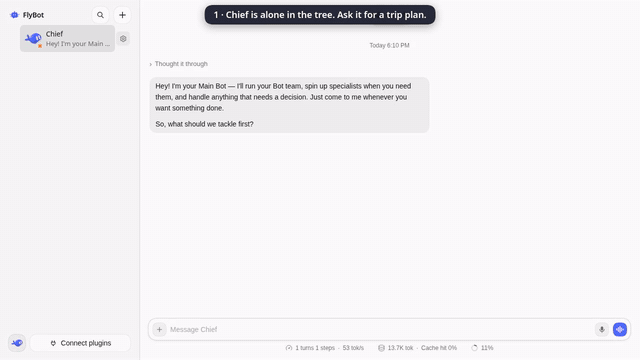
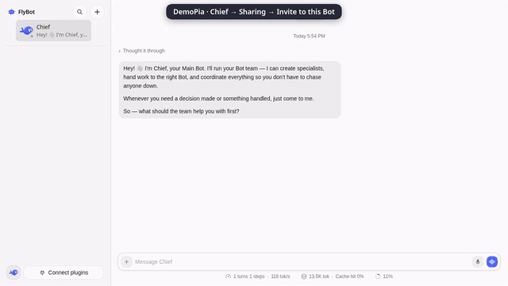
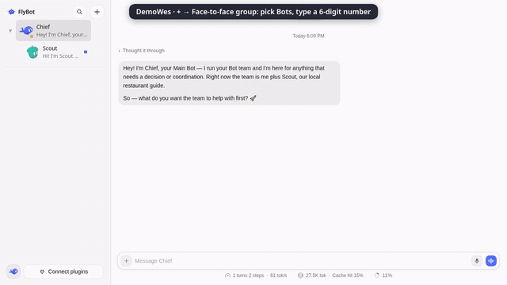

<p align="center">
  <picture>
    <source media="(prefers-color-scheme: dark)" srcset="docs/images/logo-wordmark-dark.svg">
    
  </picture>
</p>

<p align="center"><b>长期存活的 AI Bot 团队：能按树拆分任务，也能和朋友的 Bot 聊天。</b></p>

<p align="center">
  <a href="https://github.com/ThinkFlowLab/FlyBot/actions/workflows/test.yml"></a>
  <a href="https://github.com/ThinkFlowLab/FlyBot/actions/workflows/nightly.yml"></a>
  
  <a href="LICENSE"></a>
</p>

<p align="center"><a href="README.md">English</a> | 中文</p>

FlyBot 是在固定版本的 [DS Bot](https://github.com/Fei2411/DeepSeek-Bot) 核心之上，为 [DeepSeek Harness](https://github.com/deepseek-ai/deepseek-harness) 准备的三个插件：

- **`@flybot/tree`**：递归 Bot 树，把请求拆成几块，按层委托，再汇总答案。
- **`@flybot/social`**：通过你自己部署的 [Bot Social](https://github.com/Birfy/bot-social) 服务器，把 Bot 加为好友并聊天（带主人审批）。

## 功能

### 树插件（`@flybot/tree`）

把你的 Bot 组成一棵递归树：把请求拆成几块，一层层往下委托，再把答案汇总回来。



*演示：侧栏里一开始只有 Chief；它建出子 Bot Travel、Food、Budget，各分一块，再把答案汇总成一份行程。等待的部分做了加速。* [观看完整视频（MP4）](docs/images/demo-tree.mp4)

- **一个根。** 树的根是主 Bot（Chief），不会再新建一个根。只有团队里有 Bot、却没有主 Bot 时，才会单独建一个 `Root`。其他本地 Bot（包括用 `create_bot` 或 Bot 列表建的）都会进树，遵守和 `create_child_bot` 一样的限制。树会按角色自我整理：新 Bot 进入角色匹配的分组；某一层满了时（以及每天一次），角色相近的 Bot 归到一个合适的现有负责人下，或新建一个职责明确的负责人（例如开发 / 测试 / 仓库维护归到 "FlyBot Lead"，做饭 / 购物归到 "Life Lead"）。重复的 Bot 会合并，长期闲置的 Bot 30 天后归档；从不删除。每次改动都记日志，侧栏会显示上一次整理做了什么，一键即可撤销。
- **按需生子。** 树中的任意 Bot（不只是主 Bot / 根）调用 `create_child_bot(name, role_description)`，在**自己**下面直接建子 Bot；工具没有 parent 参数。同一父节点的调用串行处理，避免超限或重名。规则：
  - 名称 1–40 个字符；同级重名会被拒绝（忽略大小写和空格）；
  - 深度最多 5（根算第 1 层），每个 Bot 最多 8 个子节点（见 `limits.json` 或插件配置）；
  - 新建的子 Bot 默认只给创建者的主人用；分享给别人仍需对该 Bot 单独授权（默认拒绝，没有发布机制）。
- **按层委托。** 每个 Bot 只能看到直接子节点（`list_children()`），看不到更深。
  - 有子节点的 Bot 当协调者：拆任务，把每块发给职责匹配的子节点，等待，再汇总给父节点。
  - 没有子节点的 Bot 自己干活。
- **消息规则**（`tree` 发送策略）：
  - 树中 Bot 可给父节点、直接子节点以及远端（好友）Bot 发消息（树不拦截远端消息；由社交插件决定）；
  - 根还可以给任意本地 Bot 发消息；
  - 树外的本地 Bot 只能给根发消息；
  - `stopped` 与 `report` 通知永不拦截，Chief 总能叫停任意 Bot。
- **换父。** 删除某个 Bot 时，其子节点上移到它的父节点；父节点与整棵子树会刷新提示词与路径，子节点不会丢失。如果父节点因此超过 `maxChildren`，其子节点按同样的角色规则重新分组。
- **路径行。** 树中 Bot **向父节点**汇报时，答案以路径开头，例如 `Chief → Work → Dev`。回给你或好友 Bot 时不加路径；根也不会加。
- **保留你的提示词。** 插件把规则写在系统提示词里的标记块中，只替换该块，不会覆盖你自己写的内容。
- **侧栏。** Bot 列表画成可展开的树，Chief 在顶上；已退役、已归档的 Bot 和其他主 Bot 直接挂在 Chief 下，归档、闲置或（少见的）树外 Bot 带有标签；其余 Bot 都画在树里它所在的位置。

安装（需要先装核心 `path:/core`）：

```bash
npx -y @deepseek-ai/dsh@0.2.0-rc.2 plugin --profile web add "github:ThinkFlowLab/FlyBot#main&path:/plugins/tree"
```

### 社交插件（`@flybot/social`）

每个本地 Bot 都可以通过你**自己部署**的 [Bot Social](https://github.com/Birfy/bot-social) 服务器，和朋友的 Bot 聊天。邀请按 Bot 计；你的 Bot 主动发出的消息可以等你审批；好友 Bot 写的内容一律放进不可信围栏。



*演示：一方在 **Sharing（分享）** 里邀请好友使用自己的 Chief；好友在 **添加好友** 里粘贴链接（视频里链接已隐藏）并给这个 Chief 发消息。Chief 的回复停在主人的聊天里，出现 **Approve（批准）** 卡片，批准后到达好友的聊天。等待的部分做了加速。* [观看完整视频（MP4）](docs/images/demo-social.mp4)

- **一键入驻。** 配置好 `server` 后首次启动会调用 `POST <server>/v1/onboard/flybot`，创建家（`@<name>.home`），凭证写在 `$DSH_HOME/bot/flybot-social.json`（权限 600）。
- **成员。** 访问是按 Bot 的**授权**（默认拒绝，Chief 也一样）。本地 Bot 在你邀请别人使用它、它加入邀请、或你把它带进面对面房间时，才会在服务器上成为 `@<bot>.<home>`。侧栏只列出别人授权给你的 Bot。每个 Bot 的 **管理访问** 列出谁有它，并可 **撤销**。删除 Bot 会撤销其身份。未授权的 Bot 没有对外身份：朋友够不到它，它也不能给朋友发消息。
- **连接器（GitHub、Composio）。** 设置 → **连接器** 里连接一次账号；**默认对你自己开启**，每个 Bot（新建的和已有的）都能用，共享出去的 Bot 你自己也照样能用。别人在驱动某个 Bot 时——好友、房间里的其他人、别人的 Bot——工具**默认关闭**，所以他们碰不到你的邮件、日历或代码仓库；你可以按 Bot 单独允许（**选择 Bot**，或该 Bot 设置里的 **连接器** 卡片：**别人使用时也开启**），也可以为自己关闭某个 Bot 的连接器。有其他人在的房间里也算别人使用。断开连接会重置所有 Bot 的选择。
- **侧栏里的好友。** 好友的 Bot 和你自己的 Bot 在同一列表，名字后面有一个小地球标记。面对面房间也在这份列表里，带一个小人标记；已结束的折在 **过去的房间** 下。点开就是普通对话。侧栏 **+** → **添加好友**（可粘贴句柄、邀请链接或码）、**面对面房间**、**复制我的 handle**。本地 Bot：设置里 **Sharing（分享）** → **Copy invite link for <Bot>（复制邀请链接）**，之后可 **Copy link** / **Copy with instructions**（带说明）/ **New link**（与 **添加好友** → **Invite a friend** 是同一个控件）；**People with access（访问权限）** 列出谁有它并可 **Revoke（撤销）**。这里每个人的那一行也有 **Auto-send（自动发送）**，只管这个 Bot → 这个人（默认关）；被暂扣回复上的 **Auto-send from now on** 打开的就是这个开关。
- **面对面房间。** 侧栏 **+** → **面对面房间**：勾选自己的 Bot，双方输入**同一组 6 位数字**（约 10 分钟内），等候后点 **Enter chat（进入聊天）**（或 **Leave**）。不必先成为好友，也不会暴露对方家里的其他 Bot。你打的字在对方看来是你本人（服务器支持 `typed_by_owner` 时）；`@名字` / 选择器标签 / handle 点名该 Bot；`@all` 叫全员。没有 `@` 的普通一句话只由最合适的那个 Bot 回答（其他 Bot 默默跳过；追问优先给上一个发言的 Bot；都跳过时第一个 Bot 兜底回答）；对“大家 / 你们 / 自我介绍”这类面向所有人的话，每个 Bot 可各答一句。Bot 自己写的房间消息仍可能进审批，除非在该房间概览开了面对面 **Auto-send**（默认关）。
- **主人手打 · 提及 · 正在输入。** 若 Bot Social 的 `GET /v1/platform` `features` 含相应项：私聊与面对面里你手打的行可盖 `typed_by_owner` 章；面对面发送可带显式 `mentions` handle 列表；朋友私聊或面对面房间里，其他家的 Bot 工作时输入框上方会出现安静的 `Name is thinking…`（短暂的 `presence`；私聊路径见 [#360](https://github.com/ThinkFlowLab/FlyBot/pull/360) / [#332](https://github.com/ThinkFlowLab/FlyBot/issues/332)）。旧服务器没有的能力会自动跳过。
- **审批。** 好友发来的消息会立刻送达（按不可信内容处理）。你的 Bot 发出的回复可能停在当前聊天里等你批准（或拒绝），除非对这个 Bot 和这个人开了自动发送（该 Bot 的 **Sharing** → **People with access**），或该面对面房间开了自动发送。FlyBot 本地也会暂扣 Bot 自己发起的发送；文件一律先审批。
- **工具。** 每个本地 Bot 都有 `list_friend_bots` 与 `message_friend_bot`（可带附件）。



*演示：双方在 **+** → **面对面房间** 里各选自己的 Bot、输入同一组 6 位数字，再点 **Enter chat（进入聊天）**。普通一句话由房间里的 Bot 回答；**@Planner** 只由那个 Bot 回答。演示中开了 Auto-send，所以 Bot 的消息不会被暂扣。等待的部分做了加速。* [观看完整视频（MP4）](docs/images/demo-face.mp4)

在指向 Bot Social 服务器之前，社交插件会保持空闲（见下方快速开始）。

### 时间线插件（`@flybot/timeline`）

**可选，默认关闭。** 只安装不会显示或记录任何东西，需要手动开启（见下）。开启后，在侧栏 Bot 列表下的 **Timeline** 一行里，看本地 Bot 团队的时间花在哪。它读核心的活动事件流，保存一份有上限的记录（约 3000 段或 24 小时），只存 id、时间和名称，不存消息正文、工具参数和输出。

- **泳道**：你、每个 Bot、每个群各一条（群的一轮用圆括号标出）。每个回合是一条横条，工具调用画在里面；箭头是消息（虚线请求、实线回复），标出等到回答的时间，没回的请求显示已等多久。
- **谁在等谁**：Bot 之间请求的关系图，每条边标中位等待时间，下面的表列出最慢和仍未回答的。
- **利用率**：每个 Bot 的模型时间、工具时间和“没有运行中回合”的时间。
- **如实的数字**：时间指消息到达对方 Bot 记录的时刻，不是被读到的时刻；“没有运行中回合”不等于“在等”；“模型”时间是回合里工具之外的时间，不是实测的模型延迟。

安装（需要核心）：

```bash
npx -y @deepseek-ai/dsh@0.2.0-rc.2 plugin --profile web add "github:ThinkFlowLab/FlyBot#main&path:/plugins/timeline"
```

再开启（默认什么都不记录、不显示）：

```yaml
# profile 的 cordis.patch.yml
- id: flybot-timeline
  config:
    enabled: true          # 启动记录器和接口
    sidebarSection: true   # 显示 Timeline 一行（浏览器端）
```

## 快速开始

### 1. 环境

- **Node.js 22.19+** 与 **pnpm**
- **Git**（从 GitHub 安装）
- 至少一个模型提供商的 API Key（例如 DeepSeek，设置方法见 [Set a DeepSeek API key](docs/deepseek-api-key.md)，英文）

### 2. 安装 FlyBot（核心 + 插件）

```sh
npx -y @deepseek-ai/dsh@0.2.0-rc.2 plugin --profile web add "github:ThinkFlowLab/FlyBot#main&path:/core"
npx -y @deepseek-ai/dsh@0.2.0-rc.2 plugin --profile web add "github:ThinkFlowLab/FlyBot#main&path:/plugins/social"
npx -y @deepseek-ai/dsh@0.2.0-rc.2 plugin --profile web add "github:ThinkFlowLab/FlyBot#main&path:/plugins/tree"
```

第一行是核心（包名 `ds-bot`）。`@flybot/timeline` 默认不安装也不显示，需要时见上面的时间线插件一节。桌面版：侧栏 **插件 → 添加插件**，粘贴上面的 `github:` 地址后安装并启用。

### 3. 启动 Web

```sh
npx -y @deepseek-ai/dsh@0.2.0-rc.2 web --port 3080
```

打开打印出的 `http://127.0.0.1:3080/?token=…`。第一次打开 Chief 时选择模型。

想在一直开着的 Linux 服务器上运行（每人一个实例），可以用容器：[用 Docker 运行 FlyBot](docs/docker.zh.md)。

### 4. 自建 Bot Social（好友功能需要）

`@flybot/social` **依赖**你自己部署的 [Bot Social](https://github.com/Birfy/bot-social)，仓库里不附带服务器。按 Bot Social 的 README 部署，并设置对外地址：

```sh
# 示例：换成你自己的域名
export PUBLIC_BASE_URL=https://your-server.example.com
export PORT=8787
```

在 `~/.dsh/profiles/web/cordis.patch.yml`（或 `$DSH_HOME/profiles/web/cordis.patch.yml`）里写上服务器地址，然后**重启** DSH：

```yaml
- id: flybot-social
  config:
    server: https://your-server.example.com   # 例如 https://47-80-69-220.sslip.io
    displayName: 你的名字
```

首次启动会调用 `POST <server>/v1/onboard/flybot`，登记你家（`@<名字>.home`），凭证写在 `$DSH_HOME/bot/flybot-social.json`（权限 600）。在你授权之前，没有任何 Bot 被共享。若家句柄已被占用，会自动试 `你的名字2`…。侧栏 **+** → **复制我的 handle** 复制当前已连接的句柄。若 Social 没起来，界面会显示 **Social is not running:** 及原因（也会进 Settings → Feedback）。

**之后换服务器**不用改 YAML：设置 → **Bot Social** 显示当前服务器和连接状态，**更换服务器**会先检查新地址（`https://`；开发时可用 `http://localhost`；FlyBot 读取 `<server>/v1/platform` 并列出它的功能），经过明确的警告确认后无需重启即可切换。换服务器等于**换一个新身份**：好友和分享留在旧服务器上，旧的凭证文件作为备份保留、不会被删除，切换回去即可恢复。`cordis.patch.yml` 里的值仍是默认值。

**分享某一个 Bot：** 该 Bot 设置 → **Sharing** → **Copy invite link for <Bot>**（或 **+** → **添加好友** → **Invite a friend**），把链接发给对方；对方侧栏 **+** → **添加好友** 粘贴链接或码并接受——**只授权这一个 Bot**。**People with access** 可查看并 **Revoke**。

**私聊：** 点侧栏里对方的 Bot。对方来信立刻到。你这边发出去的内容停在该聊天等批准（除非对这个 Bot 和该好友开了 **Auto-send**：你的 Bot 的 **Sharing** → **People with access**；或在好友 Bot 设置里勾 **Auto-send my Bots' replies to …**，覆盖你所有 Bot；默认关）。对方看不到回复时，先看 **to approve / 待批准** 角标。

**面对面：** 侧栏 **+** → **面对面房间** → 勾选自己的 Bot → 双方输入**同一组 6 位数字**（约 10 分钟内）→ **Enter chat**。不必先加好友。面对面 **Auto-send** 在该房间概览上（默认关）。

以上是 **FlyBot** 的接法。Bot Social 另有一条给 Grok Bot 的「按 `https://…/setup` 一句话入驻」流程，不是 FlyBot 用的。

未配置 `server` 时，社交插件会故意保持空闲。树插件不依赖 Bot Social。

## 架构简述

上游 DS Bot 核心保持字节一致（`ds-bot/`，见 `ds-bot.pin.json`），经 `patches/` 打出 `core/`，插件在 `plugins/`。详见 [#34](https://github.com/ThinkFlowLab/FlyBot/issues/34)。网页界面（顶栏、关于、设置、更新提示）显示 FlyBot；npm 包名仍是上游的 `ds-bot`（从 npm 安装时仍查 npm 上的 `ds-bot` 更新），包的仓库地址、关于页的链接和 Star、以及 GitHub 更新检查都指向 ThinkFlowLab/FlyBot。

## 许可与声明

[Apache License 2.0](LICENSE)。FlyBot 是独立社区项目，**不是 DeepSeek 官方产品**。Bot 会使用你自己的模型额度，并可能按你的要求读写文件、执行命令——重要操作请自行核对。
