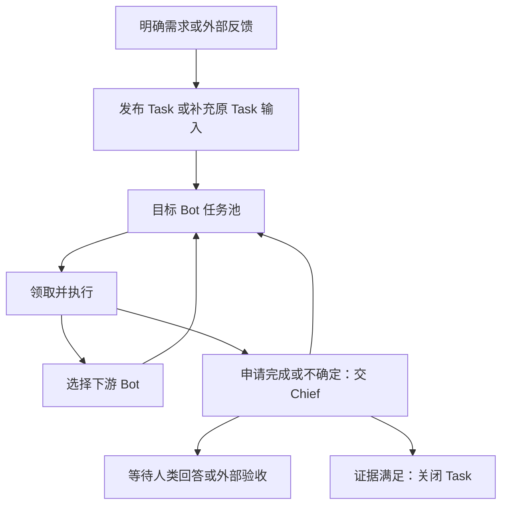

# 自动开发服务操作指南

本指南说明交付分支的实际交互、任务流转、个人代理和状态承载。
[README](../README.md) 负责连接/启动，[API 参考](development-service-api.md) 负责参数、响应和权限。
以下功能/验证边界对应业务基线1811，不把后续前端 PR 的变化算作本分支能力。

## 交互入口

| 入口 | 当前形式 | 适合的操作 |
| --- | --- | --- |
| 工作台网页 | 原 FlyBot 的 Project、公共 Chief、个人代理、群聊和任务视图 | 对话、监督项目工作；视觉与完整 UI 验收另行跟踪 |
| HTTP API | 已认证 `POST /api/bot` + v1 应用服务 | 外部程序接入、查询/控制任务和配置 |
| 命令行 | README 的 fb_api / fb_dev 函数，输出 JSON | 调试和脚本调用；没有 flybot board 交互 TUI或自动刷新表格 |
| GitHub 反馈 | 对已订阅的 Issue/PR 原生定时轮询 | 在原讨论追加要求，形成原 Task 的持久输入 |

没有单独的后端管理登录页面或 Swagger 页面。API 与工作台共用账号授权体系，
但一次 API 登录可以有自己的 Session；无需先在网页登录。进程仍与 FlyBot 共用，
不是靠命令行打开后才能维持的前台聊天会话。

## 从需求到交付的步骤

1. **讨论或提问**：问 Chief/个人代理，不创建 Task。私人代理可只把明确问题 handoff 给 Chief并收回回答。
2. **发布有项目影响的工作**：代码变更、技术决策、发布事项形成 Task；安全模式先展示私人提案并确认，
   或由有权限的人通过 task-create 明确发布。Task 有稳定 projectId、发起人和验收条件。
3. **启动**：task.run 接受运行请求，或因配额/资源排队；已发布不代表正在执行。
4. **领取与执行**：Bot 从自己的任务池领取。宿主登记 claim、资源租约、Task/角色 Session及工作区，
   再由选定 Harness 执行。人设、Skills、仓库规则和作用域记忆随执行快照提供。
5. **自主交接**：当前 Bot 选择下游、打回、转交或请 Chief裁定。框架检查当前领取/代次、权限、退出证明和产物；
   不通过则记录阻塞。不是前端按固定 DAG依次派活。
6. **验证与发布**：代码候选由宿主封存；独立宿主测试、角色 Review与PR绑定具体SHA。
   达到发布条件才更新原 PR，不用模型一句“测试通过”替代宿主证据。
7. **裁定**：申请完成/不确定的任务进入 Chief。Chief可关闭、要求测试、返工、指定下一角色或询问人类；
   仍须满足验收与候选一致性规则。Task关闭、PR合并、部署上线是不同动作。



这描述已实现的协议；并不表示每条异常恢复或个人值守都已在真实开发中完整验收。

## 一个真实走过的例子

原 Task40/PR48 的前端变更遗漏匹配架构文档。操作者在原 PR 评论指出问题后：
GitHub Source自动接入反馈 → 原 Task 输入 → Chief/Dev接手 → 真实 Codex修改文档 →
Tester及独立宿主测试 → Reviewer检查同一SHA → 原PR更新。
此次改动的候选为36147e74；没有新建一条替代开发任务。反馈的接收、读取与处理各有记录。
整个前端Task仍有实际服务/视觉等验收要求，因此文档修复通过不等于整个Task已关闭。

## 个人项目代理

每个 `(用户, Project)` 有独立私有代理身份、对话和私有笔记。换Bot载体不改变逻辑身份；
公共Chief和代码角色不自动获得任何人的私有历史。

以下示例需先按README登录并定义函数，替换 PROJECT_ID。发送消息可能调用实际模型，
不是只读连通性检查；本指南不会自动为现有账号切换值守模式。

```bash
# 当前用户自己的代理、提案、授权状态；完整读取可能确保代理存在。
fb_api project-agents '{"projectId":"PROJECT_ID"}'
# 私聊，返回 queued 后通过 history 等待实际回答。
fb_api project-agent-message '{"projectId":"PROJECT_ID","visibility":"private","text":"这个项目目前有哪些阻塞需要我处理？"}'
fb_api project-agent-history '{"projectId":"PROJECT_ID","visibility":"private"}'
```

### 普通问题交给 Chief

```bash
fb_api project-chief-question '{"projectId":"PROJECT_ID","text":"当前交付还有什么验收缺口？","requestId":"question-001"}'
```

它把明确问题交给 Chief 并返回原来的私人对话；不会创建、启动Task或公开整段私有对话。
返回的 handoff.status 是受理状态，最终回答在私有 history。相同请求ID不可换成另一个问题。

### 安全模式和发布提案

```bash
fb_dev command agent.mode '{"mode":"safe"}' 'mode-safe-001'
```

私人代理的Task工具先返回私人proposal；人类检查字段后：

```bash
fb_dev command proposal.publish '{"proposalId":"PROPOSAL_ID"}' 'approve-proposal-001'
```

这只是发布Task，随后按明确需求调用task.run。提案的正文成为公共Task，其他私有记忆不自动公开。
代理不能在模型工具参数里伪造人的确认。直接由人调用task-create属于显式发布，不是私人提案审批。

### 值守模式

```bash
fb_dev command agent.mode '{"mode":"watch"}' 'mode-watch-001'
fb_dev query execution.boundary '{}'
```

watch创建当前用户/Project的可撤销授权，不保存浏览器Cookie。退出API Session不会撤销它；
切回safe撤销。后端每次重新检查账号有效性、成员身份和权限，移除成员、停用账号、改变身份或授权代次会拒绝后续动作。

“代我操作”限于该用户当前有权执行且代理接口支持的Project操作，不能自升Owner、访问其他用户私聊，
也不因此获得全局认证管理、自动合并、发布或部署权限。后台唤醒还依赖操作者配置的实时principal校验；
没有该能力不会静默退化为长期复用浏览器Cookie。授权本身不是配置了一条自动巡检或通知调度。

**验证边界**：私聊、隔离笔记、只读问题handoff有实际交互记录；safe提案/发布有历史记录，
但早期错误地把PR查询做成Task且任务失败，不能计作成功开发。watch授权、登出续行、撤权及权限边界有测试；
尚未证明个人代理值守发起真实变更并闭环交付。当前开发主链路曾通过人类后端接口和GitHub反馈启动。
这些与“原个人Chief首次使用UI是否验收”也是不同问题。

## 状态由谁承载和更新

单机实例使用原FlyBot锁定的JSON存储。当前部署文件为
`/var/lib/flybot-shared/data/bot/state.json`；日志/产物另存并以路径、哈希关联。
它不是模型记忆文件、看板浏览器状态或一份可由Bot随意编辑的Markdown任务清单。

| 记录 | 内容/主要更新者 |
| --- | --- |
| projects / projectArchive | Project身份、仓库、成员与生命周期/删除留档；Project管理服务 |
| tasks | 需求、发起人、projectId、业务状态；任务/交付服务 |
| task.collaboration | 当前Bot、任务池状态、claim、generation、handoff历史与阻塞；任务池/Chief控制 |
| projectAttempts | 每轮执行、候选SHA、工作区及测试/Review/PR证据；交付服务 |
| projectHarnessWorkers / projectResourceLeases | 实际执行和占用、待输入、退出证明；Harness/资源服务 |
| projectTaskInputs / projectEffects | 追加输入、读取处理回执、持久副作用与恢复；输入/Effect服务 |
| projectChiefDecisions | Chief提议、所依据快照及实际应用/拒绝结果；Chief控制服务 |

人类命令、Bot结构化handoff、SDK回调或定时发生项进入后端，经过权限、当前代次、
归属和证据校验才修改记录。存储串行生成revision快照，以临时文件写入并原子rename。
需要外部动作时先保存Effect意图，确认持久提交后执行，再保存结果与回执。
不能承诺每种外部网络写入无条件exactly-once；模糊结果需要核对原远端对象。

Project当前生命周期主要为active/archived，删除后留档；尚未有完整目标/里程碑/版本/项目验收状态模型。
一条Task完成不会自动把Project标为完成。

### TaskView 读模型

原Task业务状态、协作状态、Attempt和worker分别记录事实；API的 `phase` 是统一派生结果，
不是又存一份可任意设置的任务状态。例如：result-ready + collaboration.blocked 可以合法共存，
表示已有产物但目前协作受阻。

| phase | 含义 |
| --- | --- |
| published | 已发布，没有更高优先级执行/终态事实 |
| queued / starting | 等角色/资源/容量，或执行正在准备 |
| running | 对应执行事实满足当前运行判定 |
| awaiting-input / awaiting-owner | 等当前执行回答/权限，或Chief提出人类问题 |
| awaiting-chief | 等Chief接手/裁定 |
| blocked | 协作或队列受阻，读取reason |
| publishing | 持久化发布意图仍在协调/执行，不能据此认定远端已成功 |
| awaiting-acceptance | 候选已进入验收等待，尚未accepted |
| paused / stopping | 暂停或等待确认退出，资源不一定已释放 |
| failed | 当前执行失败/中断且没有更高优先级的恢复/阻塞事实 |
| accepted / cancelled | 任务已验收/取消 |

同时读取 waitingFor、reason、currentRole、attemptId、candidateSha、evidence、inputs、effects和nextActions。
nextActions根据当前请求者权限过滤；它只是当前状态下可尝试的操作，不是绕过后续实时校验的许可。

## 操作时常见的问题

- **“成功启动”为何没有代码？** task.run可能只进入queue；从TaskView、池、Attempt和worker判断。
- **Bot说完成为何没关闭？** 模型结论不是宿主测试/Review/PR同SHA证据，也不是Chief已经应用裁定。
- **为什么换了Attempt？** 显式返工/已封存候选的修复可创建新Attempt，Task与原PR绑定继续保留。
  已确认退出的未封存interrupted干净/脏工作区，在非rework恢复路径可保留原Attempt及其集成准入。
- **为什么不能直接重试PR？** 必须核对当前候选、发布Effect、远端HEAD和退出证明；记录已保存不等于远端仍匹配。
- **为什么不让Bot自己改状态文件？** 那会绕过权限、代次和证据规则；所有变更都应走受支持的接口/宿主回调。
- **何时需要人？** 看awaiting-owner、blocked、awaiting-acceptance及原因，普通下游handoff不需逐步审批。
- **巡检在哪里？** Chief模板/项目配置与原生定时任务承载，默认示例1800秒，使用chief.state查询；不存在另一个硬编码Chief计时器。
