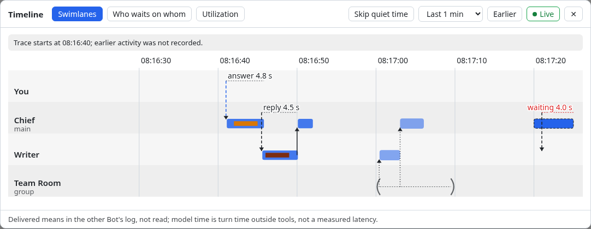
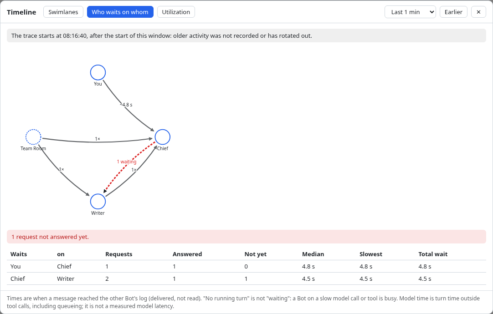
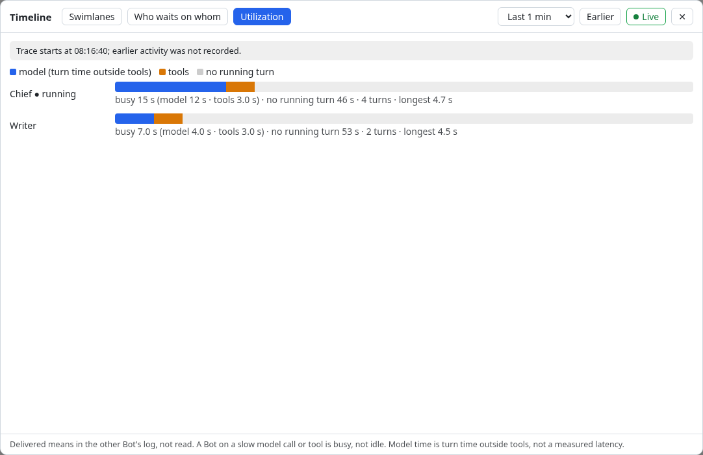

# @flybot/timeline

Where time goes across your local Bot team: which Bot was running, for how long, how much of that was tool calls, and how long a Bot waited for another Bot's answer. Built on ds-bot's team activity feed (`ctx.flybot.on('turn.start' | 'turn.end' | 'tool.start' | 'tool.end' | 'exchange.delivered')`); it never reads raw DSH session events.

## The panel

A **Timeline** row under the Bot list (the one entry; the **+** menu has none) opens a dialog with three views, polled every 2 s only while it is open and the page visible:

- **Swimlanes**: a lane for you, each Bot (Main Bot first) and each group. A turn is a bar with its tool calls inside (a failed call is darker); a turn that is still running reaches the right edge with a dashed outline. A group's round is drawn as round brackets on the group's lane, and the members' turns inside it are outlined on their own Bots' lanes. Arrows are deliveries: dashed requests, solid replies, a blue dashed arrow for what you asked; the line above a lane shows how long the sender waited for the answer ("reply 4.5 s", "answer 4.8 s"), and an open request counts up in red ("waiting 12 s"). **Skip quiet time** shrinks long stretches with nothing happening.
- **Who waits on whom**: the requests between Bots as a directed map (median wait per edge, red dashed where something is unanswered) and a table with requests, answered, not yet answered, median, slowest and total wait, longest total wait first.
- **Utilization**: per Bot, how much of the window was model time, tool time and no running turn.

The window can be 1 min to 24 h, and **Earlier** looks back (**Live** is always shown: lit while following, press it to return). Notes above the view say when the trace is shorter than the window, when it is truncated, when it is not being saved to disk, and when the host cannot be reached (the last good data stays on screen). Everything shown is text from the trace, cleaned on the host and again in the browser, and drawn as text only.





*Screenshots are rendered from a scripted team run (synthetic data) with real React, not from a live team.*

Config for the browser entry: `sidebarSection: false` hides the sidebar row, the panel's only entry (there is no **+** menu entry, #269; open it with `ctx.flybot.timeline.panel.show()`); `windowMs` sets the initial window.

## What it records

Bot turns, tool calls (name and duration only), and Bot-to-Bot / user-to-Bot deliveries (who, to whom, role, message length). Group rooms appear as the room's own round with the members' turns inside. Never message text, tool arguments or tool output.

The trace lives in `$DSH_HOME/bot/flybot-timeline/` as capped segment files: about 3000 spans or 24 hours, whichever comes first, then the oldest segment rotates out. One writer at a time (`writer.lock`); each file is replaced whole with write-tmp, fsync, rename. A second dsh on the same directory records in memory only.

## Endpoint

`flybot/timeline/window`, body `{ windowMs?, to? }` (30 s to 24 h, default 15 min; `to` looks back). It is read-only, so a read-only host answers it too. The browser entry (`client.js`) polls it every 2 s, only while a panel is open and the page visible (`ctx.flybot.timeline`).

The response (`version: 1`) has `lanes` (You, Bots, groups), `turns` (with `tools`, `trigger`, `running`, `lost`), `rounds` (group brackets), `exchanges` (arrows with request-to-reply latency), `edges` (the communication map: counts, answered, unanswered, median and max wait), `utilization` (busy, tool, model and idle ms per Bot), `coverage` and `trace` (how much history there is, whether it is being written).

## What the numbers mean

- **Delivered**, not read: the core sees when a message reached the recipient's log.
- **Idle** = no running turn. A Bot waiting on a model call or a slow tool is busy.
- **Model** = turn time outside tool calls, including queueing and host overhead. It is not a measured model latency.
- A turn an earlier run left open is closed at the last record before the restart and marked `lost`.

## Config

```yaml
- id: flybot-timeline
  name: "@flybot/timeline"
  config:
    dir: ''             # trace directory (default $DSH_HOME/bot/flybot-timeline)
    persist: true       # false: keep the trace in memory only
    segmentRecords: 2000
    segments: 3
    retentionMs: 86400000
    flushMs: 2000
```

## Install

```sh
npx -y @deepseek-ai/dsh@0.2.0-rc.2 plugin --profile web add "github:ThinkFlowLab/FlyBot#main&path:/plugins/timeline"
```

Needs the FlyBot core with the activity feed (`ds-bot` `>=0.1.5-flybot.1`; without the feed the plugin refuses to start with a clear error).

## Develop

```sh
cd plugins/timeline && npm test
```

The host test boots the real core and drives it with a mini agent loop whose model is `core/dev/mock-llm.mjs`.
